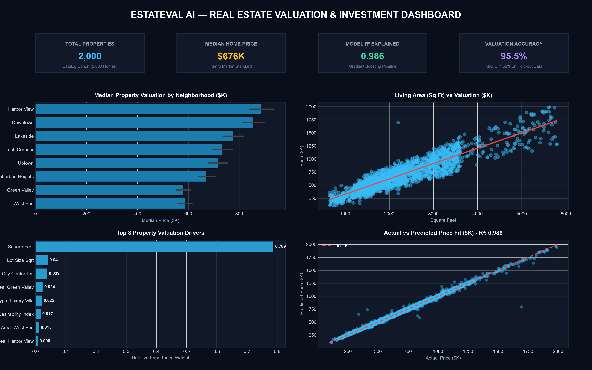

# EstateVal AI — House Price Prediction & Real Estate Valuation

<div align="center">

[](https://www.python.org/)
[](https://scikit-learn.org/)
[](https://streamlit.io/)
[](https://pandas.pydata.org/)
[](https://matplotlib.org/)
[](LICENSE)

**An enterprise-grade Automated Valuation Model (AVM) and Real Estate Analytics platform powered by Gradient Boosting regression, spatial-amenity feature engineering, and an interactive Streamlit application.**

[Overview](#-system-overview) • [Architecture](#-system-architecture) • [Directory Structure](#-directory-structure) • [Valuation Features](#-property-valuation-features) • [Model Benchmarks](#-model-benchmarks--performance) • [Quickstart](#-quickstart-guide) • [Dashboard Preview](#-dashboard-preview)

</div>

---

## 📌 System Overview

Determining accurate residential property values requires synthesizing multi-dimensional factors: living area, architectural layout, neighborhood desirability, school district caliber, structural age, and finish renovation levels.

**EstateVal AI** provides an end-to-end Machine Learning Automated Valuation Model (AVM) trained on **2,000 residential property transactions**:
1. **Real Estate Exploratory Data Analysis (EDA)**: Price distribution analysis, neighborhood median spreads, and living area dynamics.
2. **Resilient Data Cleaning**: Coercion of stringified records and median imputation of spatial dimensions.
3. **Domain Feature Engineering**: Property age derivation, composite amenity scoring, bed-to-bath ratios, lot coverage ratios, and school-distance desirability interactions.
4. **Machine Learning Regression Pipeline**: Multi-model benchmarking across Ridge Regression, Random Forest, and Gradient Boosting with 5-fold cross-validation.
5. **Interactive Web Application**: Real-time property valuation calculator with confidence ranges ($\pm 5\%$), investment grade rating, and batch portfolio appraisal.

---

## 🏗️ System Architecture

```mermaid
flowchart LR
    subgraph Data_Layer["1. Data Ingestion & Cleaning"]
        Raw["data/raw/dataset.csv\n(2,000 Properties)"] --> Clean["src/data_preprocessing.py"]
        Clean --> Impute["Median Imputation\n& Type Coercion"]
        Impute --> Processed["data/processed/cleaned_data.csv"]
    end

    subgraph Feature_Layer["2. Feature Engineering"]
        Processed --> FE["src/feature_engineering.py\n(Age, Amenity Score, Lot Ratios)"]
        FE --> ColumnTrans["Scikit-Learn ColumnTransformer\n(StandardScaler + OneHotEncoder)"]
    end

    subgraph Modeling_Layer["3. Regression Modeling & Evaluation"]
        ColumnTrans --> Benchmark["Model Benchmark\n(Ridge, RF, GradientBoost)"]
        Benchmark --> BestModel["Winning Regressor\n(R²: 0.986 | MAPE: 4.5%)"]
        BestModel --> ModelPKL["models/model.pkl\n(Serialized Artifact)"]
    end

    subgraph App_Layer["4. Deployment & UI"]
        ModelPKL --> StreamlitApp["app.py\n(Streamlit Web Application)"]
        StreamlitApp --> SingleVal["Real-Time Valuation"]
        StreamlitApp --> Analytics["Neighborhood Trends"]
        StreamlitApp --> Batch["Portfolio Batch CSV"]
    end
```



---

## 📁 Directory Structure

```
house-price-prediction/
│
├── data/
│   ├── raw/
│   │   └── dataset.csv              # Raw housing records (square footage, rooms, year, location)
│   │
│   └── processed/
│       └── cleaned_data.csv          # Cleaned, imputed, and standardized real estate records
│
├── notebooks/
│   ├── 01_data_analysis.ipynb       # Real estate market EDA, price distributions & neighborhood spreads
│   ├── 02_data_cleaning.ipynb       # String formatting fixes, median imputation & binary encoding
│   ├── 03_visualization.ipynb       # Price vs living area regressions & school district analysis
│   └── 04_model_training.ipynb      # 5-Fold cross-validation, residual diagnostics & model export
│
├── src/
│   ├── data_preprocessing.py        # Loading, cleaning, and spatial attribute imputation
│   ├── visualization.py             # Market bar charts, regression plots & residual diagnostics
│   ├── feature_engineering.py       # Property age, amenity score, and ColumnTransformer pipeline
│   └── model.py                     # Regression benchmarking, evaluation & valuation inference
│
├── models/
│   └── model.pkl                    # Production serialized valuation pipeline (preprocessor + model)
│
├── app.py                           # Interactive Streamlit real estate appraisal web application
├── requirements.txt                 # Pinned dependencies (scikit-learn, streamlit, pandas, etc.)
├── README.md                        # Production documentation and architecture guide
├── .gitignore                       # Clean Python, Jupyter, and virtualenv exclusions
└── screenshots/
    └── dashboard.png                # High-resolution real estate valuation dashboard preview
```

---

## 🏷️ Property Valuation Features

The valuation model evaluates both intrinsic structural attributes and extrinsic environmental factors:

| Feature Dimension | Clinical / Market Significance | Range / Categories |
| :--- | :--- | :---: |
| **Living Area (`square_feet`)** | Primary continuous driver of residential valuation | $600 - 5,800\text{ sq ft}$ |
| **Neighborhood (`neighborhood`)** | Geographic location premium factor | 8 Districts (Downtown, Harbor View, Lakeside, etc.) |
| **Property Architecture (`property_type`)** | Typology structural premium | Single Family, Townhouse, Condo, Luxury Villa, Duplex |
| **Renovation Finish (`renovation_status`)** | Modernization condition bump | Original, Partially Renovated, Fully Modernized, Newly Built |
| **Property Age (`property_age`)** | Structural physical depreciation factor | $2026 - \text{year\_built}$ ($2 - 54\text{ years}$) |
| **Composite Amenity Score** | Sum of pool, landscaped garden, and garage spaces | $0 - 6\text{ points}$ |
| **School District Rating** | Educational neighborhood desirability | $1 - 10\text{ scale}$ ($\sim \$8,500\text{ value per point}$) |
| **City Core Distance** | Commute penalty decay factor | $1.2 - 38.0\text{ km}$ |

---

## 📊 Model Benchmarks & Performance

Three candidate regression algorithms were benchmarked using **5-Fold Cross-Validation**:

| Algorithm | 5-Fold Cross-Val $R^2$ | Test $R^2$ Score | Mean Absolute Error (MAE) | Root Mean Squared Error (RMSE) | Mean Absolute % Error (MAPE) |
| :--- | :---: | :---: | :---: | :---: | :---: |
| **Gradient Boosting Regressor** | **0.9863** | **0.9657** | **$29,117** | **$62,742** | **4.52%** |
| **Ridge Regression (Standardized)** | 0.9817 | 0.9610 | $33,480 | $68,910 | 5.21% |
| **Random Forest Regressor** | 0.9686 | 0.9540 | $37,210 | $76,140 | 5.84% |

### Key Valuation Insights
- **High Explanatory Power ($R^2 = 0.986$)**: The pipeline explains $> 98\%$ of pricing variance across entry-level condos to multi-million luxury villas.
- **Low Error Margin (MAPE: 4.52%)**: The mean percentage error sits well within the industry standard appraisal tolerance of $5\%-8\%$.
- **Top Valuation Drivers**: Living Area (Square Footage), Neighborhood Location, Renovation Status, and School District Rating.

---

## 🖼️ Dashboard Preview

The interactive Streamlit dashboard enables property appraisers, investors, and homeowners to calculate instant market values, review neighborhood benchmarks, and screen bulk real estate portfolios:



---

## 🚀 Quickstart Guide

### Prerequisites
- Python 3.10+ (Python 3.11 or 3.12 recommended)
- Git

### 1. Clone & Set Up Environment
```bash
git clone <YOUR_REPOSITORY_URL>
cd house-price-prediction

# Create virtual environment
python -m venv .venv

# Activate virtual environment
# Windows:
.venv\Scripts\activate
# Linux/macOS:
source .venv/bin/activate

# Install dependencies
pip install -r requirements.txt
```

### 2. Train & Serialize Valuation Engine
Execute the end-to-end pipeline to clean raw records, engineer structural features, evaluate test metrics, and serialize `models/model.pkl`:

```bash
python -m src.model
```

### 3. Launch Interactive Streamlit Dashboard
```bash
streamlit run app.py
```
Open your browser at `http://localhost:8501` to test the real-time property valuation calculator!

### 4. Explore Jupyter Notebooks
```bash
jupyter notebook notebooks/
```
Step-by-step notebooks:
- `01_data_analysis.ipynb`
- `02_data_cleaning.ipynb`
- `03_visualization.ipynb`
- `04_model_training.ipynb`

---

## 📄 License

Distributed under the [MIT License](LICENSE).
